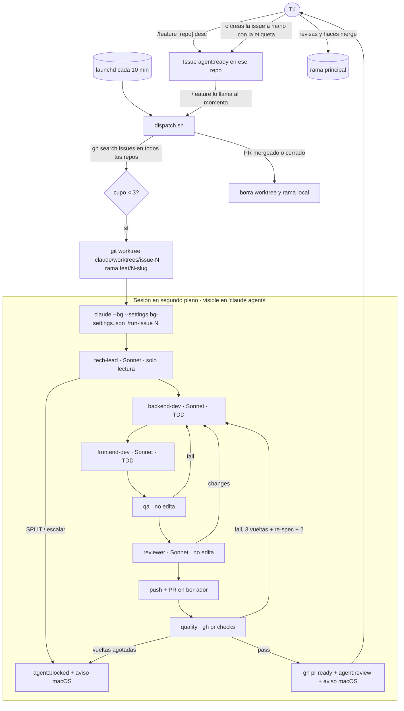

# Empresa de agentes en tu Mac (multi-repo)

Diseño vigente · 2026-10-20 · Claude Code 2.1.304. La investigación de features y buenas prácticas, con fuentes, está en [`INVESTIGACION.md`](INVESTIGACION.md).

**Premisas (tuyas):** todo corre en tu computador; los agentes viven en `~/.claude` y sirven para **cualquier** repo; commits y PRs salen con tu identidad, como siempre; **tú** revisas y haces merge.

---

## Cómo funciona



- **Una issue = una rama `<tipo>/N-slug` (`feat/12-panel-admin`, `fix/7-…`; tipo del prefijo del título o `fix` si tiene la etiqueta `bug`) = un worktree = una sesión.** Las sesiones en segundo plano no tocan tu checkout de trabajo: si la sesión ya está dentro de un worktree, Claude Code no crea otro ([doc](https://code.claude.com/docs/en/agent-view#how-file-edits-are-isolated)).
- **Sin duplicados:** el despachador cambia la etiqueta a `agent:in-progress` antes de lanzar y usa un lock con `mkdir`; solo considera issues **creadas por ti** (`--author`), lo que también corta el prompt injection de terceros.
- **Cualquier repo:** busca en todos tus repos (y en las orgs que pongas en `AGENT_OWNERS`); si el repo no está en `~/Developer/<nombre>`, lo clona ahí.
- **Stack:** los agentes no asumen ninguno. El tech-lead detecta los comandos reales del repo (CLAUDE.md, manifiestos, CI) y los incluye en el spec. `/onboard-repo` los deja fijos en `CLAUDE.md` + `.claude/verify.sh`.
- **Permisos y guardas solo para los agentes:** `bg-settings.json` (modo `auto`, allow/deny, hook `guard.sh`) se pasa con `--settings` únicamente a las sesiones despachadas. Tus sesiones normales no cambian.

## Contenido del kit

```
install.sh                               enlaces simbólicos en ~/.claude (+ launchd con --with-launchd)
home/.claude/agents/                     tech-lead, backend-dev, frontend-dev, qa, reviewer, quality
home/.claude/skills/feature/             /feature [owner/repo] <desc> → issue + despacho inmediato
home/.claude/skills/run-issue/           /run-issue <n> → pipeline completo (lo usa el despachador)
home/.claude/skills/onboard-repo/        /onboard-repo → CLAUDE.md + .claude/verify.sh vía PR
home/.claude/skills/frontend-design/     skill oficial de Anthropic (Apache 2.0), precargado en frontend-dev y designer (con emil-design-eng)
                                         Opcional: diseños propios (p. ej. de Claude Design) en <repo>/docs/referencias/<vista>.png → dev y designer los siguen; sin ellos, el pipeline sigue igual
home/.claude/skills/frontend-craft/      anti-slop UI: estados, a11y, copy, screenshot (frontend-dev)
home/.claude/skills/backend-craft/       anti-slop backend: bordes, errores, datos, seguridad (backend-dev)
home/.claude/skills/{emil-design-eng,animate,animation-performance,break-ui}/  Emil Kowalski (MIT), copia fija; ver ORIGEN
home/.claude/skills/vercel-react-best-practices/  Vercel (MIT), copia fija; ver ORIGEN
home/.claude/hooks/guard.sh              bloquea merge, aprobar, push a main/master/develop, --force, --no-verify; qa/quality/reviewer/tech-lead de solo lectura
home/.claude/hooks/require-green.sh      el dev no termina si .claude/verify.sh falla (una insistencia)
home/.claude/agent-company/dispatch.sh   cola multi-repo → worktree → claude --bg; limpia worktrees de PRs cerrados
home/.claude/agent-company/bg-settings.json
launchd/com.agent-company.dispatch.plist cada 10 min
repo-optional/.github/workflows/ci.yml   CI de PRs (verify.sh + Sonar con quality gate) para copiar en los repos que quieras
INVESTIGACION.md                         Fases 1–2 con fuentes
```

## Instalación (≈15 min)

1. `./install.sh`: enlaza agentes, skills y hooks en `~/.claude`. Si ya existe un archivo real con el mismo nombre, lo salta.
2. En cada repo donde vayan a trabajar los agentes: abre `claude` una vez y acepta el diálogo de trust. Es obligatorio: `claude --bg` desde un script falla con `Workspace not trusted` ([doc](https://code.claude.com/docs/en/agent-view#from-your-shell)). La confianza va por raíz de repo y los worktrees la heredan ([doc](https://code.claude.com/docs/en/permissions)). Ahí mismo ejecuta `/onboard-repo`.
3. Opcional, SonarQube como MCP para todos tus repos (necesita Docker):
   `claude mcp add --scope user sonarqube --env SONARQUBE_TOKEN=<user-token> --env SONARQUBE_URL=<url-si-es-server> -- docker run --init --pull=always -i --rm -e SONARQUBE_TOKEN -e SONARQUBE_URL sonarsource/sonarqube-mcp` ([repo](https://github.com/SonarSource/sonarqube-mcp-server))
4. Prueba manual en un repo pequeño: `/feature arregla X` y, mientras corre, `claude agents`.
5. Cuando la prueba salga bien: `./install.sh --with-launchd` activa el ciclo cada 10 min.

## Uso diario

| Quiero… | Hago |
|---|---|
| Pedir un feature | `/feature owner/repo descripción` (o desde dentro del repo, sin el repo) |
| Ver qué hace cada agente | `claude agents`: estados Working / Needs input / Completed / Failed; `Space` para asomarte, `→` para entrar ([doc](https://code.claude.com/docs/en/agent-view)) |
| Seguirlo desde el móvil | entra a la sesión y ejecuta `/remote-control`; aparece en claude.ai/code y en la app ([doc](https://code.claude.com/docs/en/remote-control)) |
| Ver la cola | GitHub: `label:agent:ready`, `agent:in-progress`, `agent:review`, `agent:blocked` |
| Revisar un PR grande con más rigor | `/code-review ultra <PR>` (lo lanzas tú; nube, 15–25 min, de pago tras 3 gratis) |
| Pedir cambios tras tu revisión | comenta en el PR y vuelve a poner `agent:ready` en la issue, o entra a la sesión y díselo |
| Parar todo | `touch ~/.claude/agent-company/STOP` (`rm` para reanudar); para quitar el ciclo: `launchctl bootout gui/$(id -u) ~/Library/LaunchAgents/com.agent-company.dispatch.plist` |
| Ajustar | variables `AGENT_REPOS_DIR` (por defecto `~/Developer`), `AGENT_MAX_WIP` (3), `AGENT_OWNERS` (tu usuario + orgs) |

**Avisos:** notificación de macOS cuando un PR queda listo o una issue se bloquea. GitHub no te notifica de tus propios PRs, por eso va por `osascript`.

## Features grandes: stacked PRs (sin intervención hasta el final)

Si el tech-lead divide un feature (máx. 5 sub-issues), la rama de la issue madre pasa a ser la **rama de integración** (`agent:epic`). Cada sub-issue lleva `Base: <rama>` y `Depende de #N`:
1. El despachador la lanza cuando sus dependencias están cerradas, con el worktree desde la rama de integración.
2. Con QA, revisión y calidad en verde, el agente deja su PR listo con la etiqueta `agent:stacked-ready`. **El agente no mergea.**
3. El despachador (launchd cada 10 min, `jefe`, o el propio agente al terminar) mergea con `merge-stacked.sh` —que se niega si la base es la rama por defecto—, cierra la sub-issue y lanza las que dependían de ella.
4. Al cerrarse la última, abre el PR `rama de integración → main` y avisa (Mac + móvil). **Ese es el único PR que revisas y mergeas tú.**

Si un merge falla (conflictos), la sub-issue queda `agent:blocked` y te avisa.

## Tablero y oficina

`oficina` (o `jefe`, que lo levanta en segundo plano) abre http://127.0.0.1:4500: un tablero por epic con columnas En cola → Spec → Dev → QA → Review → Tu revisión → En el epic, la vuelta de cada issue, quién trabaja ahora y el PR final cuando está listo. Debajo, la oficina de [Pixel Agents](https://github.com/pablodelucca/pixel-agents) (MIT, `npm i -g pixel-agents@1.4.1`, puerto 4510) con un muñeco por sesión y subagente.

- Datos: `board/board.py` lee GitHub (`gh issue/pr list`, caché 15 s) y la fase de cada sesión desde su transcript en `~/.claude/projects/` (último subagente lanzado). Sin hooks propios.
- Pixel Agents pide aprobar una vez, desde su página, sus hooks en `~/.claude/settings.json` (solo envían eventos a 127.0.0.1). Activa **Watch All Sessions** en sus Settings: cada issue corre en su propio worktree.

## Aprobación

Los PRs salen con tu usuario, y GitHub no deja aprobar formalmente un PR propio. Tu "aprobación" es revisar y hacer merge; lo que impide que lo haga un agente es:
- `guard.sh` y las reglas `deny` de `bg-settings.json` (merge, review, push a la rama principal, force).
- Opcional pero recomendado en cada repo: ruleset o branch protection con "Require a pull request" + "Require status checks" + bloqueo de force-push, **sin** exigir aprobaciones (tú no puedes darte una). Así tampoco cuela un push directo a main.

## Costos

Cada sesión despachada consume tu plan igual que una interactiva ([doc](https://code.claude.com/docs/en/agent-view)). No hay cifra oficial por feature: mide 3 issues piloto con `/usage` (incluye el desglose por subagente). Palancas: `AGENT_MAX_WIP` (2 por defecto), Sonnet + ponytail en todos los agentes y sesiones, `maxTurns` en cada agente y máximo 3 vueltas (+2 tras un re-spec del tech-lead). Si tienes usage credits activos, ponles un límite mensual en claude.ai/settings/usage ([doc](https://code.claude.com/docs/en/costs)).

## Plan

| Fase | Qué | Listo cuando |
|---|---|---|
| Día 1 | `install.sh`, trust + `/onboard-repo` en 1 repo, `/feature` manual | 1 PR correcto que mergeas tú |
| Días 2–3 | `--with-launchd`, 2–3 repos más, CI opcional (`repo-optional/`) | 5 issues en varios repos sin tocar el teclado |
| Semana 2 | Sonar MCP + quality gate en CI, ajustar prompts con lo que falle | bloqueos < 30% |
| Después | empaquetar el kit como plugin; un mod con un pane que muestre la cola ([doc](https://code.claude.com/docs/en/plugins/mods/overview)) | solo si lo echas en falta |

## Riesgos y límites

1. **El Mac tiene que estar encendido y despierto.** launchd no despacha mientras duerme y las sesiones en segundo plano se paran si el equipo se apaga. Para dejarlo trabajando de noche: Ajustes → Batería → impedir reposo con la tapa cerrada y el cargador conectado, o `caffeinate -s`.
2. **Modo `auto`:** si tu plan o modelo no lo soporta, o el clasificador duda, la sesión queda en **Needs input** (amarillo en `claude agents`) hasta que respondas. No se salta permisos. Es lo esperado, no un fallo.
3. **Las guardas no son un sandbox.** Un agente con Bash puede escribir aunque no tenga Edit; `guard.sh` lo reduce con regex. La barrera fuerte es el ruleset de GitHub más tu merge.
4. **Etiquetas huérfanas:** si una sesión muere a mitad, su issue queda en `agent:in-progress` y ocupa cupo. Revísalo cada cierto tiempo (`label:agent:in-progress`) y reetiqueta.
5. **Repos nuevos** clonados por el despachador no tienen trust: el primer despacho falla, la issue vuelve a `agent:ready` y te llega un aviso para abrir `claude` una vez en ese repo.
6. **Colisión de nombres:** dos repos con el mismo nombre en owners distintos comparten carpeta. Si te pasa, separa `AGENT_REPOS_DIR` por owner.
7. **No automatizar todavía:** migraciones destructivas, auth/pagos, infraestructura y secretos, upgrades mayores de dependencias, y repos sin tests. El tech-lead las escala como `agent:blocked` por diseño.
8. **Features en preview:** agent view está en research preview; revisa el [changelog](https://github.com/anthropics/claude-code/blob/main/CHANGELOG.md) al actualizar.

## Verificado y no verificado

- **Verificado aquí:** flags `--bg`, `--name`, `--settings`, `--worktree`, `--permission-mode` en Claude Code 2.1.304; flags de `gh search issues`; sintaxis de todos los scripts; plist válido; `guard.sh` (bloquea merge/review/push a main/force; deja pasar `gh pr create --draft`, `gh pr ready`, `gh pr checks`, push de la rama de la issue; solo lectura para qa) y `require-green.sh` (bloquea si `verify.sh` falla y respeta `stop_hook_active`).
- **Verificado en la prueba del 2026-10-22:** `claude --bg` lanzado desde `dispatch.sh` (vía `!` en agent view), el skill `/run-issue` se expande desde el prompt posicional de `--bg` y delega en el tech-lead; precarga de skills con prefijo de plugin (`ponytail:ponytail`) en subagentes.
- **No verificado aún:** `claude --bg` lanzado desde launchd, y que las sesiones `--bg` arranquen en modo `auto` con el `defaultMode` de `--settings`.
